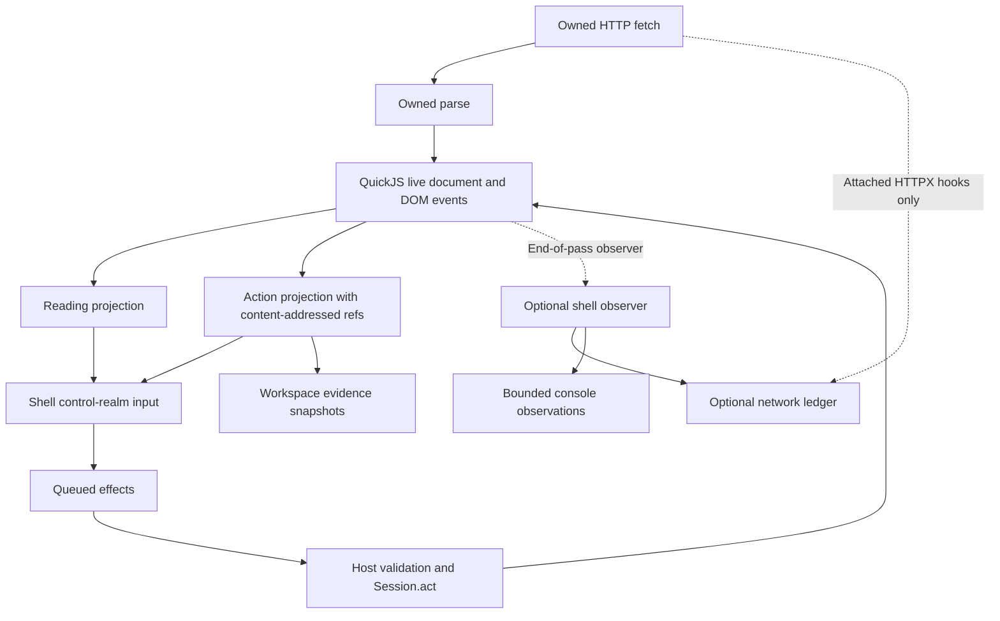

# DOSH terminal

DOSH terminal is a command surface over the browser's own document and session. It is not an operating-system shell and does not introduce another browser engine. This document describes `webresearch/shell.py` and `webresearch/telemetry.py`, checked against their callers and tests.

## Implementation status

Implemented and wired:

- `python -m webresearch shell [--database PATH] [-c 'command {...}']` (repeatable `-c`).
- `browser_shell` in the tool catalog, shared dispatcher, and MCP. HTTP `/v1/invoke` uses the same dispatcher.
- `Session.shell` lazily attaches one shell and `Session.close` closes it.
- `run_scripts` calls `_dosh_runtime_observer(info, url)` once after final drains. A callback failure is recorded as `observer_error` and does not discard the page.
- Action permission is rechecked on the host. VM output that contains actions is rejected when `allow_actions` was false. Shape, count, refs, and option names are validated before any dispatch.

This is still not a secure OS sandbox or a production secrets boundary. Scripts cannot touch host files or page globals, but page text, labels, and explicit `values=true` queries remain website-controlled data. No external browser, CDP lane, or browser binary is part of this design.

## Document architecture



The normal lifecycle remains owned fetch, parse, script execution, live DOM/events, then derived reading and action projections. The shell observes and drives that lifecycle. It does not replace the document with extracted text, turn snapshots into executable pages, or evaluate its scripts inside the page realm.

`DoshShell` attaches hooks only when constructed, permits one shell observer per client, and serializes its own commands with an asynchronous lock. Earlier activity cannot be recovered. Its `close()` removes its hooks and observer and closes SQLite; it is idempotent. This command lock is not a universal lock on every other session caller. Closing a shell also does not clear rules already stored on the client.

## Entry-point contract to integrate

The CLI interface will be:

```text
python -m webresearch shell [--database workspace.sqlite] [-c 'help']
```

`-c` must be repeatable. Each value is a command name optionally followed by a JSON argument object, not arbitrary shell code:

```sh
python -m webresearch shell -c 'help' -c 'status'
python -m webresearch shell --database workspace.sqlite -c 'db {"sql":"SELECT name,version FROM skills"}'
```

Without `-c`, the CLI reads lines from stdin, prompts with `dosh> ` only on a TTY, and stops on EOF, `exit`, or `quit`. Blank lines are ignored. Each `-c` value runs in order and prints one JSON object. There is no interactive prompt when `-c` is used.

The tool contract is `browser_shell {session_id, command, arguments}`. HTTP `/v1/invoke` and MCP route it to the same session-bound shell. The HTTP envelope is:

```json
{
  "name": "browser_shell",
  "arguments": {
    "session_id": "SESSION_ID",
    "command": "actions",
    "arguments": {"offset": 0, "limit": 100}
  }
}
```

The tool does not accept a database path. Persistence is the local CLI `--database` option; HTTP and MCP shells use memory unless the process created the session with its own shell first. `Session.shell` attaches lazily and closes with the session.

`execute(command, arguments)` returns `{"ok":true,"command":...,"result":...}` or a handled error with `ok:false`. When arguments are omitted it parses the command's trailing text as JSON. Arguments must be an object. An outer `ok:true` means the router returned a result: inspect `evaluated`, individual effects, coverage, and the document before concluding success.

## Command reference

Limits below are defaults unless stated otherwise. Public query `limit` arguments accept integers from 1 to 1000. Boolean values are not integer budgets.

| Command | Arguments and actual behavior |
| --- | --- |
| `help` | Lists commands and notes on isolated scripting, attachment-time capture, sensitive values, and unsupported rollback. |
| `status` | Reports session/tab IDs, redacted URL, whether the top document has a live realm, workspace persistence, network coverage, and cumulative log count. |
| `open` | Requires `url`; `js` defaults to `always`. Calls `Session.goto` and returns URL, HTTP status, title, and page view. |
| `actions` | `offset=0`, `limit=100`. Builds the top-level control inventory before paging and merges live visibility annotations where refs match. Returns actions, total, returned, omitted-before/after counts, and `next_offset`. Frames are separate. |
| `act` | Requires `ref`; accepts `text`, `dx`, `dy`. Calls `Session.act`, returning status and view. Dispatch completion is not proof that the intended website outcome occurred. |
| `net` | `after=0`, `limit=100`, `pattern=""`. Queries observations using a literal substring of the redacted URL. Returns retention, pagination, cursor, and source-coverage details. |
| `net.capture` | Requires boolean `enabled`. Toggles opt-in JSON/form response-body capture for future activity. Does not recover earlier bodies. |
| `net.rule` | Requires `action` and `pattern`; `method="*"`, `options={}`. Adds a runtime fetch/XHR `block`, `header`, or `mock` rule. See scope below. |
| `net.unrule` | Requires rule `id`. Removes an exact matching rule and returns whether one was removed. |
| `console` | `after=0`, `limit=100`, optional exact `level` filter. Messages are withheld unless `values=true`. Returns omitted-limit/retention counts and `next_after`. Runtime ingestion happens through the end-of-pass observer. |
| `eval` | Requires `source`; `args={}`, `allow_actions=false`. Runs synchronous JavaScript in a fresh control realm. Host validation rejects unauthorized, oversized, or malformed effects before dispatch. |
| `skill.save` | Requires `name`, `source`, and explicit `origins`; `allow_actions=false`. Saves or replaces a registry entry, computing SHA-256 and incrementing its version. |
| `skill.list` | `limit=100`. Lists name, hash, serialized origins, action permission, and version without running source. Returns SQL-style row coverage. |
| `skill.run` | Requires `name`; `args={}`. Checks the loaded document's exact origin. An action-enabled saved skill also requires `allow_actions=true` on the run. Returns name, version, hash, and script result. |
| `skill.delete` | Requires `name`. Deletes the registry entry and reports whether it existed. |
| `db` | Accepts `sql`, positional `params=[]`, `limit=100`. Defaults to listing workspace tables. Executes read-only SQL with an authorizer and progress budget. Returns rows, returned count, and `has_more`. |
| `storage` | Optional `frame` ref. Defaults to local/session storage key lists and IndexedDB database/version/store metadata. `values=true` requests recursively key-redacted values. Requires a live realm. IndexedDB is currently per-realm and in memory. |
| `snapshot` | Stores title, redacted URL, and top-level action `ref`/`kind`/`label` evidence with time and tab ID. Returns a workspace snapshot ID. No DOM text or heap checkpoint. |
| `diff` | Requires snapshot IDs `before`, `after`. Reports added, removed, or changed action records keyed by ref and whether the URL changed. Label changes can produce new refs rather than an in-place change. |
| `layers` | Optional `frame` ref. Calls the live realm's `__inspectLayers()` and reports approximate strata with explicit limitations. Not authoritative hit testing. |
| `frames` | Lists loaded frame refs, parents, redacted URLs, status, live-realm presence, recorded/delivered message counts, and script-error counts. Reports bounds of 16 frames and depth 3; withholds message payloads. |
| `tabs` | Lists session tabs with redacted URLs. Supplying `id` switches tabs before listing them. It does not create or close tabs. |

The shell's `act` command does not expose every option of the broader browser API. For example, it does not accept file uploads. Its control-realm action options are limited to `text`, `dx`, and `dy`.

## Control-realm JavaScript

The SDK is deliberately small:

- `dosh.args`: caller-supplied JSON object.
- `dosh.text()`: the loaded page's reading text, not raw markup.
- `dosh.actions()`: a copied list containing only `ref`, `kind`, `label`, `disabled`, and `hidden`.
- `dosh.find(label)`: all actions with an exact matching label. Duplicate labels remain ambiguous.
- `dosh.emit(key, value)`: appends structured output.
- `dosh.act(ref, options)`: queues an action rather than immediately touching the page.

URLs, selectors, form values, and hidden payload fields are excluded from the action projection. Reading text, labels, and caller arguments can still contain sensitive or page-controlled data.

```js
const matches = dosh.find(dosh.args.label);
dosh.emit("matches", matches);
```

A mutating script should reject ambiguous, hidden, or disabled matches and request explicit permission. It should then verify the resulting document through a separate observation. The script cannot observe the result of its own queued action during that evaluation.

| Resource | Implemented limit |
| --- | --- |
| Source | 64 KiB UTF-8, nonempty |
| QuickJS execution time | 250 ms |
| QuickJS memory | 16 MiB |
| QuickJS stack | 256 KiB |
| Serialized input projection | 2,000,000 bytes |
| Serialized output | 1,000,000 bytes |
| SDK emits | 100 |
| SDK queued actions | 20 |

A fresh QuickJS context receives no host callbacks, filesystem API, network API, live page globals, or page-evaluation bridge. No promise jobs are pumped. Asynchronous continuations are not an alternative action lane. The VM time limit does not bound subsequent HTTP requests or session actions.

Evaluation errors produce `evaluated:false` and no dispatched effects. After successful evaluation, Python validates queued refs against the initial available controls and checks option names. It re-resolves availability before each sequential action and stops on a stale ref or dispatch error. Earlier effects are not undone. This is neither a transaction nor rollback.

The SDK checks are convenience only. After evaluation, Python rejects action lists unless the original `allow_actions` argument was true. It also rejects malformed envelopes, more than 100 emits, more than 20 actions, unknown refs, disabled or hidden controls, and unsupported option keys. Those checks happen before the first `Session.act` call. Direct writes into `__out` cannot bypass that host gate. This still does not make the control realm a production security sandbox: it is a bounded projection and an action queue, not a proven isolation product.

## Skills and workspace data

Skills are explicit stored source, not code discovered from websites or fetched automatically. Names are 1 to 64 characters, starting with a letter or digit and continuing with letters, digits, dots, underscores, or hyphens. Origin allowlists must contain canonical HTTP(S) origins with no paths, credentials, or wildcards. Scheme, host, and nondefault port matter.

Each saved entry records source, its pinned SHA-256, origins, saved action permission, and an integer version. Replacing a name starts a new version; `skill.run` uses the current stored entry and returns its identity. This is not immutable version history, a signature, or caller-side expected-hash verification. Action-enabled skills require permission both when saved and when run. The host permission gate still applies.

SQLite contains two workspace tables, `skills` and `snapshots`. With no path it is `:memory:`. A supplied local path opts into persistence. Skills contain executable source and snapshots retain titles and labels, so this file is potentially sensitive.

`db` reads this workspace only. It is not SQL access to the website's backend, a website SQLite/WASM database, cookies, localStorage, or IndexedDB. Its SQLite authorizer denies writes, attach operations, and file/extension helper functions; a progress handler bounds query work. Other shell commands deliberately write registry entries and snapshots. Read-only query results can still expose saved source or evidence if explicitly selected.

Snapshots are evidence only. They cannot restore the DOM, JS heap, cookies, browser storage, network responses, or server-side state. A diff does not prove semantic equivalence of documents and does not replay anything.

## Telemetry and network policy

`NetworkLedger.attach()` appends request/response hooks to the supplied `httpx.AsyncClient`, preserving existing hooks. Importing telemetry installs nothing. The default ledger retains 1000 observations; the console deque retains 1000 entries. Returned network records are independent copies.

There are two observation sources, not one comprehensive network trace:

1. Attached HTTPX client hooks. Curl impersonation, other clients, and cache responses that bypass those hooks are outside this coverage.
2. Explicit `resource_requests` batches passed to `record_runtime`. The runtime calls the session observer once, after final drains. The caller must still submit each batch only once. A second shell on the same client is refused.

Runtime and HTTPX observations are not deduplicated. Neither source establishes causal linkage between an agent command, script task, and every request. Missing runtime failures cannot be inferred from absent records.

HTTPX request starts receive monotonically increasing IDs. Before response headers, failures or cancellation remain `unresolved` because HTTPX provides no failure hook here. Headers arriving are not proof of body completion. The stream wrapper observes normal consumption without reading ahead; it records completion, stream failure type, or early closure. `network_sent:null` means transmission is unknown, not confirmed. Explicit runtime mocks, blocks, and cache hits report `false`.

`net.after` is a request-start cursor, not an update feed. Re-query an earlier cursor to refresh unfinished records. `omitted_retention` counts evicted IDs, whose filter matches are unknown; `omitted_limit` counts retained matching rows not returned. A ledger result marked complete is complete only within its declared observation scope, not all website traffic.

### Rules are selective, not universal

Rules are stored on the client and consumed by runtime `host_fetch` for fetch/XHR. They do not intercept HTTPX hooks, navigation, every subresource path, WebSockets, or all other clients. There is no all-network selective-enforcement guarantee.

- `block` returns a blocked runtime result without sending that request.
- `header` adds configured request headers for matching runtime calls.
- `mock` returns configured status, content type, and string body without sending that request.

`method` defaults to `*`. Patterns use the runtime's literal-substring OR regular-expression matching; even literal-looking patterns must compile as regexes. An empty pattern matches everything within this limited lane. Rules run in stored order: headers can accumulate before a block or mock returns. Options support `enabled`, plus `headers` for header rules or `status`, `content_type`, and `body` for mocks. Returned rule metadata excludes payloads, but raw rule payloads remain in the client's in-memory policy store for execution.

### Data handling

Body capture is off by default. Request bodies and exception messages are not retained by the ledger. With capture enabled, only complete UTF-8 JSON or URL-encoded form response bodies are eligible. The default cap is 16 KiB for both input and redacted serialized output. Unsupported, oversized, invalid, partial, and encoded streamed bodies are omitted instead of exposing prefixes. Runtime bodies may already be limited upstream; ambiguous runtime `body` fields are used only for explicit mocks.

URL userinfo and fragments are discarded and all query values are redacted. Secret-like header names and nested JSON/form keys are redacted. Metadata caps are 64 headers, 128 characters per header name, 1024 per value, and 2048 per URL. Paths, innocently named fields, titles, labels, and arbitrary text can still contain secrets. Key-based redaction is not a general secret detector.

Console message values are withheld by default; `values=true` explicitly reveals free-form, untrusted page output. Script-error detail is withheld. Storage defaults to metadata and requires `values=true` for key-redacted values. These defaults do not mean every shell result is sanitized: page views and readable text remain website content.

## Agent goals and capability limits

An agent should be able to establish what it can read, what it can do, which ref identifies each control, and what remains unavailable. Preserve the full control inventory separately from article-reading filters. Use content-addressed refs as evidence-linked action targets, not permanent element identities across arbitrary mutations.

Page through `actions` using `next_offset` and report omissions. Page through network and console results with retention loss disclosed. Shell inventories use an internal collection ceiling of 1,000,000 actions; this is bounded enumeration, not a proof of unlimited coverage. The action inventory is top-level, so `frames` alone does not supply a complete child-control projection.

For each attempted task, distinguish evaluation, dispatch, visible document change, and verified website outcome. An HTTP status, emitted claim, or successful click dispatch is not by itself evidence that login, checkout, submission, or a challenge succeeded. Unsupported engine controls remain unavailable even if a ref exists.

`layers` provides heuristic flow/chrome/scroller/overlay/hidden classifications, not GPU layers or CSS stacking-context semantics. Occlusion uses box centers and z-index. Hidden controls are not proof of honeypots, and `aria-hidden` does not itself mean visually hidden. Lists cap at 80/50/40/40/60 respectively; reported capped counts are returned counts, not page totals.

`frames` describes loaded, bounded frame documents and message counters. It does not establish complete frame loading, full browser frame semantics, message-payload inspection, VM stepping, or debugger support. Missing engine capabilities must be named and implemented in the owned engine, never bypassed with an external browser.

## Verification and concrete next steps

Run `python -m pytest tests/test_shell.py tests/test_telemetry.py` after changes. Network tests are hermetic. The captured-markup inventory test loads `testhtml/test1.html` into the document and pages the action surface; it does not go through the reading snapshot, which has a separate expensive path in `content.py`.

Still not implemented:

1. Causal run IDs linking a command, tab, realm, action, and every transport request. Current observations overlap and are not deduplicated.
2. One policy boundary across HTTPX, curl impersonation, navigation, stylesheets, scripts, frames, fetch/XHR, cache, and WebSocket. Rules today apply to runtime `host_fetch` only.
3. Message records with sender, receiver, origin, order, and a bounded payload policy. Frames currently report counts.
4. A step debugger with pause, resume, and task boundaries. Snapshots and console logs are not that debugger.
5. A faster reading snapshot for very large captured pages. `open` has a 30 second bound so a stuck reading pass fails instead of hanging the terminal.

No replay, rollback, universal interception, or debugger capability is implied by these next steps.
